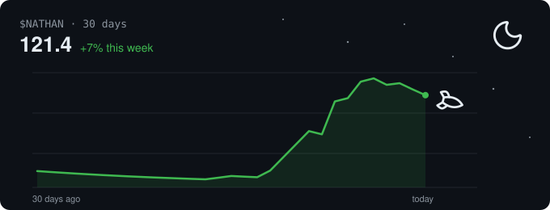
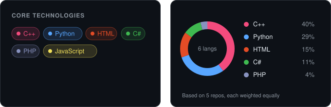

# Hi, I'm Nathan

**Computer Science student at the University of Central Arkansas, class of 2027.**
I build software and the tests that keep it working.

## Projects

- **[TCG Tournament Manager](https://github.com/nchiamsachang/tcg-tournament-manager)**: C++/Qt desktop app for the Bear TCG club, with regression and UI test suites
- **[Steam Game Recommender](https://github.com/nchiamsachang/Steam-Recommender-System-Linear-Algebra)**: recommendations from 41 million Steam reviews
- **[Game Engine Simulation Benchmark](https://github.com/nchiamsachang/Game-Engine-Simulation-Benchmark)**: C# versus Python, with shared boundary tests
- **[E-Book Storefront](https://github.com/nchiamsachang/First-store-Web-Technologies)**: JavaScript cart with PHP/MySQL checkout

## Languages

