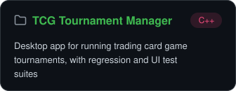
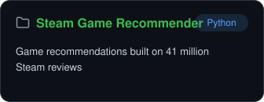
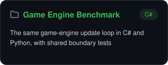

# Hi, I'm Nathan

**Computer Science student at the University of Central Arkansas, class of 2027.**
I build software and the tests that keep it working.

<!-- Each badge is two images: a label that is not a link (the <picture> wrapper stops GitHub linking it) and the button beside it that is. -->

<picture></picture>
<picture></picture>
<picture></picture>

## Languages

## Projects

